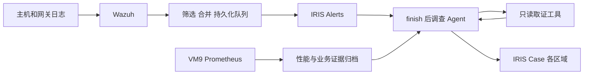

# 第五组日志监控与事件调查

本项目负责攻防演练中的日志监控。Wazuh 汇集网关、员工终端、应用、数据库和备份服务器的日志；转发程序将重点告警送入 IRIS；演练结束后，调查 Agent 查询相关记录，整理案件摘要、时间线、任务、资产、笔记和证据。

VM9 性能接口读取 Prometheus 历史指标，将 CPU、内存、负载、磁盘和网络数据与同一主机、同一时段的 Wazuh 告警关联。指标用于解释资源变化和业务影响，原始安全告警等级保持不变。

项目地址：https://github.com/EchO-NN/group5-log-monitor

## 项目范围

- Wazuh 原始等级不低于 7 的告警，以及指定账号和关键路径的低等级白名单。
- 五分钟窗口合并重复告警，保留成员记录、时间和来源哈希。
- 每次 `begin` 建立独立 Case，`finish` 后启动工具调用式调查。
- 通过 SSH 查询 VM2 至 VM9 的日志和文件，管理连接由本机 SSH 配置提供。
- 从 VM9 读取九类 Prometheus 指标，保存历史采样并提供联合查询。
- 调查结果分次写入 IRIS，支持进度查看、分页、故障重试和人工修改保护。

## 数据流



## 本地运行

Python 3.10 及以上即可运行核心模块和测试。离线样例不访问虚拟机、IRIS 或模型 API。

```bash
git clone https://github.com/EchO-NN/group5-log-monitor.git
cd group5-log-monitor
make test
make demo
python3 -m venv .venv
. .venv/bin/activate
python -m pip install build
make build
```

## 接入实验环境

按 [部署说明](docs/deployment.md)配置 SSH 别名、IRIS 地址和模型提供商。密钥保存在仓库外的本地文件中，示例配置不包含可用密钥。

```bash
./监控自动化.sh begin --label "第五组正式演练"
./监控自动化.sh status
./监控自动化.sh finish
watch -n 2 './监控自动化.sh ai'
```

## 实现与验证

| 项目 | 结果与记录 |
|---|---|
| Wazuh Agent 4.14.9 源码编译 | 已编译，保留源包与五个程序的 SHA-256，见 [构建记录](docs/verification/wazuh-source-build.json) |
| 2026 年 11 月 5 日实际演练 | Case 2 完成跨主机调查，见 [案例分析](docs/case2.md) |
| 2026 年 11 月 15 日 VM9 扩展 | 采集、入库、汇总和告警关联代码已实现，本地测试见 [测试记录](docs/verification/local-tests.json) |
| VM9 在线联调 | VM9 离线，本次未执行在线联调 |

Case 2 的历史结论来自当时取得的日志，新增性能接口没有用于补写该次演练的指标结果。

## 目录

```text
scripts/monitoring/       日志入库 告警筛选 AI 调查 IRIS 适配 性能分析
scripts/                 操作入口 SSH 采集 构建与测试
configs/                 示例配置 Wazuh 规则 systemd 单元
docs/                    架构 部署 性能接口 案例 验证记录
.github/workflows/       持续集成
```

重点阅读：[技术报告](docs/report.md)、[AI 调查机制](docs/agent.md)、[VM9 性能接口](docs/performance.md)、[验证方法](docs/testing.md)。

本仓库仅发布日志监控项目代码、配置模板和脱敏验证摘要。运行数据库、原始日志、真实密钥、浏览器配置和攻击脚本未纳入仓库。
